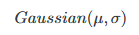

# Probability Distributions

```{r}
library(tidyverse)
library(ggplot2)
```

Probability provides a systematic way to describe and reason abot events whos outcomes cannot be predicted with certainty.

Rules:

- None-negativity rule states that no probability can be less than 0.

- Normalization requires that the probability of all possible outcomes of a situation must add up to exactly 1, which guarantees that something in the set of probable outcomes must happen.

- Addition tells us that if two events cannot bot occur at the same time, the probability of either happening is the sum of their individual probabilities

- Multiplication applies when two events are independant, so their outcome does not affect the other

## Distributions

a probability distribution is a way of describing how probabilities are asigned to all possible outcomes of a random process. Conceptually it is a distribution of probabilities (a list of possible outcomes as values and their probabilities).

Instead of focussing on a single event, distribution gives the full picture it gives us the probability of every possible value a random variable can take.

**discrete probability distributions** apply to discrete variables. Here probabilities are assigned to distinct values, and the total across all possible outcomes must equal to 1. So on a six-sided die, each outcome has a 1/6 probability since there are six outcome: 1/6 \*6 =1.

**continuous probability distributions** are used when outcomes can take on any value within a range, such as height, reaction times or phone duration. In this cases the probability is described by a smooth curve rather than discrete points, and instead of assigning probability to individual values, we consider intervals like, for example, the probability that a persons height lies between 160cm and 170cm

```{r}
p <- 0.8
bernoulli_df <- tibble(
  x = c("No", "Yes"),
  probability = c(1 - p, p)
)

ggplot(bernoulli_df, aes(x = factor(x), y = 0 , yend = probability)) +
  geom_segment(colour = "steelblue", linewidth = 2) +
  geom_point(aes(y = probability), colour = "steelblue", size = 5) +
  labs(x = element_blank(), y = "Probability") +
  ylim(0, 1)
```

```{r}
alpha <- 1.5
beta <- 4
beta_df <- tibble(
  x = seq(0, 1, length.out = 100),
  density = dbeta(x, alpha, beta)
)

ggplot(beta_df, aes(x = x, y = density)) +
  geom_line(color = "darkorange", linewidth = 1.2) +
  labs(x = "Proportion of voicing", y = "Density")
```

where the top is categorical (discrete) and the bottom is continuous.

Probability distributions are more than just mathematical descriptions—they provide tools for making sense of variation and uncertainty in the world. They allow us to calculate probabilities for complex events, to compare different random processes, and to build models that reflect real-world randomness. Once the distribution of a random variable is known, we can derive useful summaries such as averages, variability, and the probability of extreme outcomes. In this way, probability distributions bridge the abstract rules of probability with the practical task of describing how probability operates across a whole set of possibilities.

## Probability mass and density functions

How is the probability of different outcomes of ranges of outcomes calculated? For discrete distributions, the **probability *mass* function** (PMF) is used to compute probabilities. Let’s take the Bernoulli probability distribution from figure [Figure 18.1 (a)](https://stefanocoretta.github.io/qdal/ch-probability.html#fig-distr-1): the PMF of a Bernoulli distribution is 𝑝 for the probability of the outcome being 1, and 𝑞 =1 −𝑝 for the probability of the outcome being 0. In the figure, 1 = “Yes” and 0 = “No”. There is a probability 𝑝 =0.8 of getting a “Yes”, hence there is a probability 𝑞 =1 −𝑝 =1 −0.8 =0.2 of getting a “No”. Continuous probability distributions use **probability *density* function**s (PDFs, nothing to do with the file format): these don’t tell you the probability of a specific value, but rather the *probability density* or in other words how dense the probability is around a point. I will spare you the mathematical details of PDFs, but they are the reason for using density plots. You’ve encountered a density plot already, in [Figure 18.1 (b)](https://stefanocoretta.github.io/qdal/ch-probability.html#fig-distr-2) above. The curve you see in that figure is calculated with the PDF of the beta distribution. Because we used a PDF, this is a theoretical probability distribution. In practice, you will almost never have to use PMFs and PDFs yourself, but it helps to know about them.

What if we want the density of a sample from a random variable, like logged RTs from the MALD data set ([Tucker et al. 2019](https://stefanocoretta.github.io/qdal/references.html#ref-tucker2019))? Obtaining the density curve of a sample is done with **Kernel Density Estimation** (KDE): this is a function that creates a smooth, continuous estimate of a probability density from a finite set of data points (the sample). As with PMFs and PDFs, you will very rarely have to use KDE directly, since R applies it for you. So let’s see how to make a density plot in ggplot2.

## Density Plots

You can create a density plot (a plot that shows the density curve as obtained from a KDE) of sample values from a continout variable with the density geometry: `geom_density()`

```{r}
# First read the data
mald <- readRDS("./data/tucker2019/mald_1_1.rds")

mald |> 
  ggplot(aes(RT)) +
  geom_density() +
  labs(x = "Reaction Times (ms)")
```

This shows the density of reaction times from MALD in milliseconds. The higher the curve the higher density around the values below that part of the curve. In this sample of RTs, the density is hught at around 900ms. It drops quite sharply below 900 ms to about 500, while on the other side of 900 it has a more gentle slope. When a density plot looks like that, we say the distribution is **right-skewed** or that is has **positive skew**. This is because the distribution is skewed towards larger values. We can visualise this better by adding a “rug” to the plot with `geom_rug()`. This geometry adds a tick below the curve, on the *x*-axis, for each value in the sample. Look at [Figure 18.3](https://stefanocoretta.github.io/qdal/ch-probability.html#fig-density-rt-rug). Note how dense the ticks are where the density is high, and how sparse the ticks are where the density is lower. This makes sense, that’s what the density represents. Setting `alpha = 0.1` makes the ticks transparent so that the denseness is even more obvious (darker areas mean greater density because the ticks overlap, thus becoming darker). Now also notice how there are many more ticks to the right of the highest part of the density than to the left. This is the right-skewness we were talking about. This aspect will be relevant when you will learn about regression models in later chapters, but in fact we will not directly address this again until [Chapter 31](https://stefanocoretta.github.io/qdal/ch-regression-lognorm.html).

```{r}
mald |> 
  ggplot(aes(RT)) +
  geom_density() +
  geom_rug(alpha = 0.1) +
  labs(x = "Reaction Times (ms)")
```

Density plots can also be made for different groupings, like in the following plot where we show the density of the RTs depending on the lexical status of the word (real or non). You can use the `fill` aes to fill the area under the density curve with colour by `IsWord`. The next code shows the densities of RTs depending on lexical status. It is subtle, but we can see that the density peak for nonce words (`IsWord = FALSE`) is to the right of the peak for real words. This means that we can expect on average higher RTs for nonce words than for real words. Moreover, the curve for nonce words is overall lower than that for real words: this means that RTs with real words are more tightly concentrated around the peak, while RTs with nonce words are more spread.

```{r}
mald |>
  ggplot(aes(RT, fill = IsWord)) +
  geom_density(alpha = 0.7) +
  geom_rug(alpha = 0.1) +
  scale_fill_brewer(type = "qual") +
  scale_colour_brewer(type = "qual") +
  labs(x = "Reaction Times (ms)")
```

## Exercise:

Read `winter2016/senses_valence.csv` and:

- produce a density plot of affective valence `val`, with densities split and areas coloured by `modality`

- remove the black density curve only the filled area should be shown

- add a rug also coloured by modality

- change the labels

- find the pattern

```{r}
senses_valence <- read_csv("./data/winter2016/senses_valence.csv")

senses_valence |>
  
ggplot(aes(Val, fill = Modality, )) +
  geom_density(alpha = 0.7, colour = NA) +
  geom_rug(alpha = 0.2 ) +
  scale_fill_brewer(type = "qual") +
  scale_color_brewer(type = "qual") +
  labs(x = "affective valence")
  
```

Solutions:

- to remove the black density curve, you need to specify `colour` in the `geom_density` and set it to `colour = NA`

# Working with distributions

Different **probability distribution families** have a different number of parameters and different parameters. A probability family is an abstraction of specific probability distributions that can be represented with the same set of parameters. An example of a probability distribution family is the **Gaussian** \[ˈgaʊsɪən\] **probability distribution**, also called the “normal” distribution and nick-named the “bell-curve”, because it looks like the shape of a bell.

```{r}
ggplot() + 
  aes(x = seq(-4, 4, 0.01), y = dnorm(seq(-4, 4, 0.01))) + 
  geom_path(colour = "sienna", linewidth = 2) + 
  labs(
    x = NULL, y = "Density"
  )
```

The Gaussian distribbution is a continuous probability distribution and it has two parameters:

- The **mean**, represented with the Greek letter 𝜇 \[mjuː\]. This parameter is the probability’s central tendency. Values around the mean have higher probability than values further away from the mean.

- The **standard deviation**, represented with the Greek letter 𝜎 \[ˈsɪgmə\]. This parameter is the probability’s dispersion around the mean. The higher 𝜎 the greater the spread (i.e. the dispersion) of values around the mean.

Go-to summary measures for continous variables are the mean and standard deviation. When you dont know exaclty what the underlying distribution of a variable is and all you want is a measure of central tendency and of dispersion, one assumes a Gaussian distribution and calculates the mean and Std. Note that in most cases we know a bit more than that and in fact the Gaussian distribution is very rare in nature. This is why we will call it Gaussian and not “normal”, since it is only “normal” from a statistical-theoretical perspective (it has simple mathematical properties that makes it easy to use in applied statistics).

In statistical notation the Gaussian distribution family is written like this:

> 

The next figure shows Gaussian distributions with fixed standard dev (2) but different means (-5, 0, 10) in the first figure and in the second Gaussin distributions with fixed mean (5) but different sds (1,2,4). The mean shifts the distribution horizontally (lower values to the left, higher to right) whilst, SD affects the width of the distribution (lower SDs correspond to a narrower or tighter distribution whild higher show wider) Since the total area under the curve has to sum to 1, if the distribution is narrower, the peak will also be relatively higher while a wider one will have a relatively lower peak.

```{r}
x <- seq(-10, 20, length.out = 1000)
means <- c(0, -5, 10)
sd_fixed <- 2

df_means <- crossing(x = x, mean = means) |> 
  mutate(
    y = dnorm(x, mean = mean, sd = sd_fixed),
    mean = factor(mean)
  ) |> 
  arrange(mean, x)

mu <- ggplot(df_means, aes(x = x, y = y, color = mean)) +
  geom_line(linewidth = 1) +
  labs(x = NULL, y = "Density", caption = "SD = 2.")

sds <- c(1, 2, 4)
mean_fixed <- 5

df_sds <- crossing(x = x, SD = sds) |> 
  mutate(
    y = dnorm(x, mean = mean_fixed, sd = SD),
    SD = factor(SD)
  ) |> 
  arrange(SD, x)

sig <- ggplot(df_sds, aes(x = x, y = y, color = SD)) +
  geom_line(linewidth = 1) +
  labs(x = NULL, y = "Density", caption = "Mean = 5.")

plot(mu)
plot(sig)
```

Specific types of Gaussian distributions will have specific values for the parameters 𝜇 and 𝜎: for example 𝐺⁡𝑎⁢𝑢⁢𝑠⁢𝑠⁢𝑖⁢𝑎⁢𝑛⁡(0,1), 𝐺⁡𝑎⁢𝑢⁢𝑠⁢𝑠⁢𝑖⁢𝑎⁢𝑛⁡(50,32), 𝐺⁡𝑎⁢𝑢⁢𝑠⁢𝑠⁢𝑖⁢𝑎⁢𝑛⁡(2.5,6.25), and so on. All of these specific probability distributions belong to the Gaussian family. So hopefully you understand now why we say that a distribution family stands for specific families: here 𝐺⁡𝑎⁢𝑢⁢𝑠⁢𝑠⁢𝑖⁢𝑎⁢𝑛⁡(𝜇,𝜎) stands as the parent of all the specific Gaussian distributions (i.e. all of the Gaussian distributions with a specific mean and SD).

## Cumulative distribution Function (CDF)

A good way to investigate theoretical probability fistributions is to ask what is the probability that a random variable the probability represents is les than or equal to a certain value. For example for a distribution 𝐺⁡𝑎⁢𝑢⁢𝑠⁢𝑠⁢𝑖⁢𝑎⁢𝑛⁡(0,1) of the random variable 𝑋, what is the probability that 𝑋 is -1 or less? The next figure gives us a visual explanation: the size of the shaded area under the density curve is the probability that 𝑋 ≤−1. This works because the area under the density curve must add to 1, so that the entire area under the curve covers 100% of the probability distribution.

```{r}
q <- -1
p <- pnorm(q)
lbl <- sprintf("P(X \u2264 %.0f) = %.4f", q, p)

df <- tibble(x = seq(-4, 4, length.out = 2000)) |>
  mutate(dens = dnorm(x))

df_shade <- df |> filter(x <= q)

ggplot(df, aes(x, dens)) +
  geom_line(linewidth = 1) +
  geom_area(data = df_shade, aes(y = dens), alpha = 0.4) +
  geom_vline(xintercept = q, linetype = "dashed") +
  annotate("text", x = q - 3, y = dnorm(0) * 0.4, label = lbl, hjust = 0) +
  labs(
    y = "Density", x = "X"
  )
```

The mathematical function that calculates the probability that a variable is less than or equal to a value is the CDF. In R, you can get the CDF value of a Gaussian distrivution ( the probability that X is less than or equal to any value x) with the `pnorm()` function (`p` for probability and `norm` for normal or Gaussian) The function takes three arguments:

- The x value is represented by the `q` argument

- The mean and the SD of the Gaussian distribution (default values are 0 and 1 respectively)

```{r}
pnorm(q = -1, mean = 0, sd = 1)
```

```{r}
# or
pnorm(-1, 0, 1)
```

```{r}
# or
pnorm(-1)
```

Calculate the probability that 𝑋 is:

- less than or equal to -2 with 𝐺⁡𝑎⁢𝑢⁢𝑠⁢𝑠⁢𝑖⁢𝑎⁢𝑛⁡(0,1)

```{r}
 # we know the mean (0) and SD (1)

pnorm(-2, mean = 0, sd = 1)
```

- less than or equal to +1.75 with 𝐺⁡𝑎⁢𝑢⁢𝑠⁢𝑠⁢𝑖⁢𝑎⁢𝑛⁡(0,1).

```{r}
pnorm(1.75, 0, 1)
```

- less than or equal to 700 with 𝐺⁡𝑎⁢𝑢⁢𝑠⁢𝑠⁢𝑖⁢𝑎⁢𝑛⁡(900,200).

```{r}
pnorm(700, 900, 200)
```

**note**: `pnorm()` calculates the probability to the left of a value, for example $P(X≤2)$ it calculates the probability of $X$ . To do something like $P(X>2)$ where $X ~- N(0,1)$ (tilde) we are calculting the probability to the right so we would do:

```{r}
1- pnorm(2, 0, 1)
```

By default, `pnorm()` uses the lower-tail CDF: this returns the "less than or equal to" probability. It is on the lower tail of the distribution, or tail to the left of the density peak. But we can compute upper-tail probability. Shown in the next figure with $X ≥ -1$ with $Gaussian(0,1)$ . To obtain the upper tail probability with `pnorm()` set `lower.tail = FALSE`:

`pnorm(-1, lower.tail = FALSE)`

```{r}
q <- -1
p <- pnorm(q, lower.tail = FALSE)
lbl <- sprintf("P(X \u2265 %.0f) = %.4f", q, p)

df <- tibble(x = seq(-4, 4, length.out = 2000)) |>
  mutate(dens = dnorm(x))

df_shade <- df |> filter(x >= q)

ggplot(df, aes(x, dens)) +
  geom_line(linewidth = 1) +
  geom_area(data = df_shade, aes(y = dens), alpha = 0.4) +
  geom_vline(xintercept = q, linetype = "dashed") +
  annotate("text", x = q + 3, y = dnorm(0) * 0.4, label = lbl, hjust = 0) +
  labs(
    y = "Density", x = "X"
  )
```

\^upper tail probability with Gaussian(0,1)

## Intervals

Porbability intervals provide a further way of lacting and interpreting values within a probability distribution. They partition the distribution into regions associated with specified probability levels. A **quantile** is a value below which a given proportion of the distribution lies. You can think of this as the opposite of finding the probability given $x$ : the probability given $q$ , which is $x$ ? For a continuous distribution like the Gaussian, the q-th quantile (denoted $Q(q)$ ) is defined as the value $x$ such that:

$P(x≤x) = q,0≤q≤1$

which is, $q$ is the probability that outcome $X$ is less than or equal to $x$ . For example if we have $Gaussian(0,1)$ which is the 0.15th quantile? To calculate the quantile, the quantile function is used which is the inverse of the CDF. The next figure shows that the 0.15th quantile of a $Gaussian(0.1)$ distribution is approximately -1.04.

```{r}
p <- 0.15
q <- qnorm(p)
lbl <- sprintf("Q(%.2f) = %.4f", p, q)

df <- tibble(x = seq(-4, 4, length.out = 2000)) |>
  mutate(dens = dnorm(x))

df_shade <- df |> filter(x <= q)

ggplot(df, aes(x, dens)) +
  geom_line(linewidth = 1) +
  geom_area(data = df_shade, aes(y = dens), alpha = 0.4) +
  geom_vline(xintercept = q, linetype = "dashed") +
  annotate("text", x = q - 2.5, y = dnorm(0) * 0.4, label = lbl, hjust = 0) +
  labs(
    y = "Density", x = "X"
  )
```

A good way to remember these is that:

- `pnorm()` -\> you know the value of X and want to find its probability

- `qnorm()` -\> you know the probability and want to find the corresponding value of X.

`qnorm()` takes three arguments, the probability, the mean and SD of the Gaussian dist. Similar to `pnorm()` you can obtain the upertail quantile value with `lower.tail = FALSE`. with a $Gaussian(0,1)$ the upper-tail quantile value is the same as the lower tail but with the opposite sign.

Known X → `pnorm()` → probability

Known probability → `qnorm()` → X

The following code shows how to use `qnorm()` (the values are rounded to the second digit with `round(2)`)

```{r}
# Lower-tail quantile with Gaussian(0, 1)
qnorm(0.15) |> round(2)
```

```{r}
# Upper-tail quantile with Gaussian(0, 1)
qnorm(0.15, lower.tail = FALSE) |> round(2)
```

```{r}
# Lower-tail quantile with Gaussian(10, 2)
qnorm(0.15, 10, 2) |> round(2)
```

```{r}
# Upper-tail quantile with Gaussian(10, 2)
qnorm(0.15, 10, 2, lower.tail = FALSE) |> round(2)
```

## Quartiles

**Quartiles** are quantiles that splits the dist into four quartes, each holding 25% of the probability mass. With a Gaussian probability, the first quartile marks the point below whoch 25% of the area lies, the 2nd quartile (called the median) splits it at 50% and the third leaves 25% abovve it, so that it covers 75% of the area. Because of the symmetry of the Gaussian, the fist and third quartiles are equidistant from the mean. The next figure shows the quartiles on a Gaussian dist. with (0,1).

```{r}
quartiles <- qnorm(c(0, 0.25, 0.5, 0.75, 1))
quart_labels <- c("Q1", "Q2 (median)", "Q3")

df <- tibble(x = seq(-4, 4, length.out = 2000)) |>
  mutate(dens = dnorm(x))

df <- df |> mutate(
  quartile = case_when(
    x <= quartiles[2] ~ "Q1",
    x <= quartiles[3] ~ "Q2",
    x <= quartiles[4] ~ "Q3",
    TRUE ~ "Q4"
  )
)

ggplot(df, aes(x, dens, fill = quartile)) +
  geom_area(alpha = 0.5) +
  geom_line(linewidth = 1) +
  scale_fill_brewer(type = "seq", direction = -1) +
  geom_vline(xintercept = quartiles[2:4], linetype = "dashed", alpha = 0.5) +
  annotate(
    "label",
    x = quartiles[2:4],
    y = 0.2,
    label = c("Q1", "Q2", "Q3")
  ) +
  annotate(
    "text",
    x = c(-1.3, -0.35, 0.35, 1.3),
    y = 0.05,
    label = c("25%", "25%", "25%", "25%")
  ) +
  annotate(
    "errorbar",
    xmin = quartiles[2], xmax = quartiles[4],
    y = 0.1,
    colour = "purple", linewidth = 1, width = 0.025
  ) +
  annotate(
    "text",
    x = 0, y = 0.12,
    label = "IQR"
  ) +
  labs(
    y = "Density", x = NULL
  ) +
  theme(legend.position = "none")
```

Notice how the Q2 splits it in half: 50% of the dist. is to the left and to the right. The interval between Q1 and Q3 is called the inter-quartile range (IQR) which indicates the middle 50% of the probability distrivution. $IQR = Q3 - Q1$ .

to get the quartiles of a Gaussian dist use the `qnorm()`function as a quartile is a type of quantile.

```{r}
qnorm(c(0.25, 0.5, 0.75)) |>
  round(2)
```

**Calculate the quartiles of the following Gaussian distributions**

$Gaussian(10,2)$

```{r}
qnorm(c(0.25, 0.5, 0.75), 10, 2) |>
  round(2)
```

`qnorm()` expects arguments in the following order `qnorm(probability, mean, sd)`

$Gaussian(900,200)$

```{r}
qnorm(c(0.25, 0.5, 0.75),900,200)|>
  round(2)
```

$Gaussian(-30,10)$

```{r}
qnorm(c(0.25, 0.5, 0.75),-30, 10)|>
  round(2)
```

## Percentiles

are a type of quantile. They split the probability into 100 percentiles each with 1% of the probability mass.

Percentiles are used to define central probability intervals, i.e. probability intervals that leave equal probability in both tails of the distribution. It is usually implied that you mean a central interval, so you don’t really have to say “central” every time. A (central) 95% interval is defined as the interval between 2.5th and the 97.5th percentile of the distribution. [Figure 19.7](https://stefanocoretta.github.io/qdal/ch-gaussian.html#fig-ninetyfive) illustrates the 95% interval of 𝐺⁡𝑎⁢𝑢⁢𝑠⁢𝑠⁢𝑖⁢𝑎⁢𝑛⁡(0,1). The shaded are is the 95% interval, while the two white areas at the tails hold each 2.5% of the distribution, thus making the rest 5% of the distribution not included in the 95% interval. Remember, probability intervals leave equal probability on both tails.

```{r}
p <- 0.15

df <- tibble(x = seq(-4, 4, length.out = 2000)) |>
  mutate(dens = dnorm(x))

df_shade <- df |> filter(x >= qnorm(0.025) & x <= qnorm(0.975))

ggplot(df, aes(x, dens)) +
  geom_area(data = df_shade, aes(y = dens), alpha = 0.4) +
  geom_line(linewidth = 1) +
  annotate(
    "label", x = 0, y = 0.15, label = "95% interval"
  ) +
  annotate(
    "text",
    x = c(qnorm(0.025) - 0.1, qnorm(0.975) + 0.15), y = 0.1,
    label = c("2.5th", "97.5th")
  ) +
  labs(
    y = "Density", x = "X"
  )
```

# Bayesian Inference

In [Chapter 18](https://stefanocoretta.github.io/qdal/ch-probability.html) and [Chapter 19](https://stefanocoretta.github.io/qdal/ch-gaussian.html) you learned about probabilities, probability distributions and probability intervals. Statistical inference ([Chapter 7](https://stefanocoretta.github.io/qdal/ch-inference.html)) is built on probability, but, while probabilities and distributions are precise mathematical concepts, their more philosophical interpretation varies depending on which stance one adopts. Among the two most common approaches to interpreting probability there are the frequentist and the Bayesian approach. Most of current research is carried out with frequentist methods. This is a historical accident, based on both an initial misunderstanding of Bayesian statistics (which is, by the way, older than frequentist statistics) and the fact that frequentist maths was much easier to work with (and personal computers did not exist). Despite the wide-spread use of frequentist statistics, this textbook (and related course) teaches you statistics in the Bayesian approach. There are several reasons for preferring Bayesian over frequentist statistics, both from a pedagogical and practical perspective, but until you learn more about frequentist statistics in [Chapter 27](https://stefanocoretta.github.io/qdal/ch-null-ritual.html), you will have to trust us for now.

Probabilities in a **frequentist framework** are about average occurrences of events in a hypothetical series of repetitions of those events. Imagine you observe a volcano for a long period of time. The number of times the volcano erupts within that time tells us the **frequency** of occurrence of the event of volcanic eruption. In other words, it tells us its (frequentist) probability. In the **Bayesian framework**, probabilities are about the **level of (un)certainty** that an event will occur at any specific time given certain conditions. This is probably the way we normally think about probabilities: like in the weather forecast, if somebody tells you tomorrow it will rain with a probability of 85%, you intuitively know that it is very likely that it will rain tomorrow although it is not certain. In the context of research, a frequentist probability tells you the probability of obtaining the same result again and again given an imaginary series of replications of the study that generated that probability. On the other hand, a Bayesian probability tells you the probability of your hypothesis given the results of your study and your prior beliefs.

Bayesian inference approaches are now gaining momentum in many fields, including linguistics. The main advantage of Bayesian inference is that it allows researchers to answer research questions in a more straightforward way, using a more intuitive take on uncertainty and probability than what frequentist methods can offer. Bayesian inference is based on the concept of **updating prior beliefs in light of new data**. Given a set of **prior probabilities** and **observations**, Bayesian inference allows us to revise those prior probabilities and produce **posterior probabilities**. This is possible through the Bayesian interpretation of probabilities in the context of [Bayes’ Theorem](https://www.mathsisfun.com/data/bayes-theorem.html), which takes the name from [Rev. Thomas Bayes](https://en.wikipedia.org/wiki/Thomas_Bayes) (1701–1771).

In simple conceptual terms, the Bayesian interpretation of Bayes’ Theorem states that the probability of a hypothesis ℎ given the observed data 𝑑 (the *posterior probability*) is proportional to the product of the *prior probability* of ℎ and the probability of 𝑑 given ℎ (the *likelihood*).

## 𝑃⁡(ℎ∣𝑑)∝𝑃⁡(ℎ)⋅𝑃⁡(𝑑∣ℎ)

The prior probability 𝑃⁡(ℎ) represents the researcher’s beliefs towards ℎ. These beliefs can be based on expert knowledge, previous studies or mathematical principles.

Let’s see a practical example of Bayesian updating based on the “globe-tossing” scenario described in McElreath ([2020](https://stefanocoretta.github.io/qdal/references.html#ref-mcelreath2020)), Ch 2 (originally from [Gelman, Nolan & Nolan 2011](https://stefanocoretta.github.io/qdal/references.html#ref-gelman2011)). Imagine holding a small globe that represents Earth. You want to know what fraction of its surface is covered by water. To estimate this, you adopt a simple method: toss the globe into the air, and when you catch it, note whether the spot under your right index finger is water (W) or land (L). Then toss it again and repeat. This process produces a sequence of observations. For example, the first nine outcomes might be: WLWWWLWLW. In this sequence, six outcomes are water and three are land. We call this sequence the data, i.e. 𝑑. What we are trying to estimate here is the true proportion of water.

So what about our prior beliefs about the true proportion of water, i.e. 𝑃⁡(ℎ)? Let’s say that our prior belief (assuming complete ignorance about the true proportion of water) is that all proportions of water are equally probable. This is called a **uniform prior**, or a **flat** prior. You can see why in [Figure 20.1](https://stefanocoretta.github.io/qdal/ch-bayes.html#fig-prior-update). If you look at the top-left panel (the one with “n = 1”), the dashed line represents our prior belief: all proportions of water (on the *x*-axis) are equally probable, so that the prior probability distribution is flat. Note that a probability of 0 means Earth is all land, and a probability of 1 means Earth is all water.

Now, let’s update the flat prior distribution with the first observation in the globe-tossing exercise: the first outcome was W, water. This observations corresponds to a distribution in which 1 has the greatest probability and values below it have decreasing probability. This is represented in the top-left panel of [Figure 20.1](https://stefanocoretta.github.io/qdal/ch-bayes.html#fig-prior-update) as the solid slanted line. This is 𝑃⁡(𝑑 ∣ℎ). If we combine the flat prior and the probability of the data we get the dashed line in the second top panel (with “n = 2”). That is the posterior probability distribution resulting from the Bayesian update at step “n = 1”. This becomes the prior probability distribution at step “n = 2”.

```{r}
# Code adapted from: https://bookdown.org/content/4857/small-worlds-and-large-worlds.html#bayesian-updating.

sequence_length <- 50

d <- tibble(toss = c("w", "l", "w", "w", "w", "l", "w", "l", "w")) |> 
  mutate(n_trials  = 1:9,
         n_success = cumsum(toss == "w"))

d |> 
  expand_grid(p_water = seq(from = 0, to = 1, length.out = sequence_length)) |> 
  group_by(p_water) |> 
  # to learn more about lagging, go to:
  # https://www.rdocumentation.org/packages/stats/versions/3.6.2/topics/lag
  # https://dplyr.tidyverse.org/reference/lead-lag.html
  mutate(lagged_n_trials  = lag(n_trials),
         lagged_n_success = lag(n_success)) |> 
  ungroup() |> 
  mutate(prior      = ifelse(n_trials == 1, .5,
                             dbinom(x    = lagged_n_success, 
                                    size = lagged_n_trials, 
                                    prob = p_water)),
         likelihood = dbinom(x    = n_success, 
                             size = n_trials, 
                             prob = p_water),
         strip      = str_c("n = ", n_trials)) |> 
  # the next three lines allow us to normalize the prior and the likelihood, 
  # putting them both in a probability metric 
  group_by(n_trials) |> 
  mutate(prior      = prior / sum(prior),
         likelihood = likelihood / sum(likelihood)) |>   
  
  # plot!
  ggplot(aes(x = p_water)) +
  geom_line(aes(y = prior), 
            linetype = 2) +
  geom_line(aes(y = likelihood)) +
  scale_x_continuous("proportion water", breaks = c(0, .5, 1)) +
  scale_y_continuous("plausibility", breaks = NULL) +
  theme(panel.grid = element_blank()) +
  facet_wrap(~ strip, scales = "free_y")
```

Now let’s update our latest prior with the probability taken from the second observation: this was L, land. The solid line in the second panel is the probability of getting a W and L: the probability indicates that a proportion of 0.5 is the most probable. This makes sense: if in two tosses you got one W and one L, then the most probable hypothesis is that there is 50% of water and 50% of land. We combine again our prior (dashed line) with the data (solid line) to obtain the dashed line in the third top panel. This is our new prior. The rest of the figure shows how the prior gets updated at each new observation of W or L. You see that the highest density of the dashed lines quickly moves to the right. They are now suggesting that the globe has a higher proportion of water than land. Chapter 2 of McElreath ([2020](https://stefanocoretta.github.io/qdal/references.html#ref-mcelreath2020)) goes into much more details and I recommend you read that at some point if you feel this section felt a bit too abstract.

Hopefully you can appreciate how different the frequentist and Bayesian approaches are: while frequentist statistics focusses on the rejection of a null/nil hypothesis based on the probability of the data given the hypothesis, or 𝑃⁡(𝑑 ∣ℎ), Bayesian statistics is about obtaining the probability of any hypothesis given the data, or 𝑃⁡(ℎ ∣𝑑). You might also realise now that 𝑃⁡(𝑑 ∣ℎ) appears in Bayes’ Theorem. But the theorem also includes the prior, 𝑃⁡(ℎ). The prior is missing in the frequentist approach.

# Gaussian Models

A satistical model is a simplified mathematical decription of how observed data are generated, together with assumptions about uncertainty in relation to the data-generating process. A model uses observed data (your sample) to identify the characteristic of the probability distribution that generates that data in the outside world.

In the context of a quant research study, an objective could be to find out the values of the paramaters of the probability distrivution of a variable of interest: VOT, numver of telic verbs, informativity score, acceptability ratings, RTs, etc.

Let’s imagine we are interested in understanding more about the nature of reaction times in auditory lexical decision tasks (lexical decision tasks in which the target is presented aurally rather than in writing). We can revisit the RT data from Tucker et al. ([2019](https://stefanocoretta.github.io/qdal/references.html#ref-tucker2019)) to try and address the following research question:

> RQ: In a typical auditory lexical decision task, what are the mean and standard deviation of reaction times (RTs)?

The mean and SD are impirtant because we are assuming that reaction times are distributed according to a Gaussian probability distribution. We will stick with Gaussian distributions for now.

In statistical notation we can write:

## $RT∼𝐺⁡𝑎⁢𝑢⁢𝑠⁢𝑠⁢𝑖⁢𝑎⁢𝑛⁡(𝜇,𝜎)$

read as "reaction times are distributed according to a Gaussian distribution with mean 𝜇 and standard deviation 𝜎. So the question is finding the values of mean and SD.

Assume the sample mean and SD are also the population of mu and sigma 𝐺⁡𝑎⁢𝑢⁢𝑠⁢𝑠⁢𝑖⁢𝑎⁢𝑛⁡(𝜇 =1010,𝜎 =318)

The next figure shows the prob dist (grey is a density curve calculated with the Kernel Density Estimation) and the theoretical prob dist in purple based on the sample mean and SD.

```{r}
library(glue)
mald <- readRDS("data/tucker2019/mald_1_1.rds")

rt_mean <- mean(mald$RT)
rt_sd <- sd(mald$RT)
rt_mean_text <- glue("mean: {round(rt_mean)} ms")
rt_sd_text <- glue("SD: {round(rt_sd)} ms")
x_int <- 2000

ggplot(data = tibble(x = 0:300), aes(x)) +
  geom_density(data = mald, aes(RT), colour = "grey", fill = "grey", alpha = 0.2) +
  stat_function(fun = dnorm, n = 101, args = list(rt_mean, rt_sd), colour = "#9970ab", linewidth = 1.5) +
  scale_x_continuous(n.breaks = 5) +
  geom_vline(xintercept = rt_mean, colour = "#1b7837", linewidth = 1) +
  geom_rug(data = mald, aes(RT), alpha = 0.1) +
  annotate(
    "label", x = rt_mean + 1, y = 0.0015,
    label = rt_mean_text,
    fill = "#1b7837", colour = "white"
  ) +
  annotate(
    "label", x = x_int, y = 0.0015,
    label = rt_sd_text,
    fill = "#8c510a", colour = "white"
  ) +
  annotate(
    "label", x = x_int, y = 0.001,
    label = "theoretical distribution",
    fill = "#9970ab", colour = "white"
  ) +
  annotate(
    "label", x = x_int, y = 0.0003,
    label = "empirical distribution",
    fill = "grey", colour = "white"
  ) +
  labs(
    subtitle = glue("Gaussian distribution: mean = {round(rt_mean)} ms, SD = {round(rt_sd)}"),
    x = "RT (ms)", y = "Relative probability (density)"
  )
```

the purple curve is the density curve of the theoretical probability distribution 𝐺⁡𝑎⁢𝑢⁢𝑠⁢𝑠⁢𝑖⁢𝑎⁢𝑛⁡(1010,318). We know by now that any sample mean and SD is biased, due to uncertainty and variability. What we are really after is the values of 𝜇 and 𝜎 which are the mean and standard deviation of the Gaussian distribution of the *population* of RTs in auditory lexical decision tasks. In other words, we want to make inference from the sample to the population of RTs.

You will also appreciate that the theoretical distribution doesn’t match well the empirical distribution. In real research contexts, there can be multiple reasons behind this. A common misconception is that the family distribution should be chosen on how well the theoretical family matches the empirical distribution. Sometimes, this can indeed indicate a problem with the chosen family, but in other cases the mismatch could be because of other aspects related to model specification. For the time being, let’s not worry about the potential cause of the mismatch and let’s proceed.

## Gaussian Models

a tool we can use to obtain an estimate of $\mu$ and $\sigma$ is the Gaussian Model. It is a stas model that estimates the values of parametes of a (theoretical) Gaussian distribution ie $\mu$ and $\sigma$ we cab describe the model formulae like this

$RT\sim Gaussian(\mu,\sigma)$

$\mu = ...$

$\sigma = ...$

Bayesian appraoches assume uncertainty in the parameters of the dist you are estimating. So not only the observed values of RT are uncertain because they come from a probability dist, but the parameters of the dist are uncertain. You can think of the mean and SD as uncertain variables that need to be estimated from the data. When we say a variable is uncertain, we describe it using a probability distribution. So the aim of a Gaussian model is to estimate the probability distributions of the parameters from the data (and the priors), rather than just their values.

$RT \sim Gaussian(\mu, \sigma)$

$\mu \sim P(\mu_1,\sigma_1)$

$\sigma \sim P(\mu_2, \sigma_2)$

We say that 𝜇 comes from a probability distribution 𝑃⁡(𝜇1,𝜎1). We use a subscript 1 to differentiate the mean and SD of the main 𝐺⁡𝑎⁢𝑢⁢𝑠⁢𝑠⁢𝑖⁢𝑎⁢𝑛⁡(𝜇,𝜎) distribution from the mean and SD of the probability distribution of the mean 𝜇. Similarly, we say that 𝜎 comes from a probability distribution 𝑃+⁡(𝜇2,𝜎2): 𝑃+⁡() is a (non-technical) way to indicate that the probability should include only positive values. Why? Because SDs can only be positive. By specifying 𝑃+⁡() we are constraining the probability distribution of 𝜎 to have positive values only. In sum, we need to estimate two probability distributions, 𝑃⁡(𝜇1,𝜎1) and 𝑃+⁡(𝜇2,𝜎2). These are **posterior probability distributions**, because they are probability distributions that result from the product of prior probability distributions and the evidence from the data.

# Fitting Gaussian models with brms

```{r}
library(brms)

fit1 <- brm(count ~ zBase, prior = prior(normal(0, 10), class = b), data = epilepsy, chain = 1)
```

This is how you model the formula

```{r}
library(brms)
brm(
  formula = RT ~ 1,
  family = gaussian,
  data = mald
)
```

RT \~ 1 and family = gaussian tells brms to model RT using a Gaussin Distribution...This means that the probability distribution of the mean and the standard deviation of the Gaussian distribution of RTs will be estimated from the data. `RT ~ 1` might look very weird to you right now, but it will become clear in the next couple of chapters why it is that way. For now, just accept that that is the way you write a Gaussian model in R.

- We specify the data with `data = mald`.

As with other R functions, we want to assign the output of `brm()` to a variable, here `rt_bm`. We will then be able to inspect the output in `rt_bm`. Now run the Gaussian model of RTs (don’t forget to attach the brms package and read the data, like in the following code).

```{r}

mald <- readRDS("data/tucker2019/mald_1_1.rds")

rt_bm <- brm(
  RT ~ 1,
  family = gaussian,
  data = mald
)
```

The messages in the text are related to Stan and the statistical algorithm used by Stan to estimate the parameters of the model (in this model, these are the mean and the standard deviation of RTs). `Compiling Stan program...` tells you that brms has instructed Stan to compile the model specified in R and that Stan is now compiling the model to be run on the data (don’t worry if this does not make sense). `Start sampling` tells us that the statistical algorithm used for estimation has started. This algorithm is the Markov Chain Monte Carlo algorithm, or MCMC for short. The algorithm is run by default four times; in technical terms, *four MCMC chains* are run. This is why information on Chain 1, 2, 3, and 4 is printed. We will treat MCMC in more details in [Chapter 25](https://stefanocoretta.github.io/qdal/ch-regression-draws.html).

Now that the model has finished running and that the output has been saved in `rt_bm`, we can inspect it with the `summary()` function (note that this is different from `summarise()`!) .

```{r}
summary(rt_bm)
```

Let’s break down the summary bit by bit:

- The first few lines are a reminder of the model we fitted:

  - `Family` is the chosen distribution for the outcome variable (`RT` in our model), here a Gaussian distribution.

  - `Links` lists the link functions. You don’t need to worry about these now.

  - `Formula` is the model formula.

  - `Data` reports the name of the data and the number of observations.

  - Finally, `Draws` has information about the MCMC algorithm. Again, you can discard those for now.

- Then, the `Regression Coefficients` are listed as a table. They are called regression coefficients because brms fits Bayesian *regression* models and a Gaussian model is a special type of regression model (you will learn about regression models in later chapters). In the Gaussian model we fitted now, we only have one regression coefficient, `Intercept`, which corresponds to 𝜇 from the formula above (for the reason why it is called that, you will have to wait until regression models are introduced in the following chapter; I apologise for the many promissory explanations…). You will learn how to interpret the `Regression Coefficients` table below.

- The `Further distributional parameters` are also in the form of a table. Here we only have `sigma` which is 𝜎 from the formula above. The table has the same columns as the `Regression Coefficients` table.

## Posterior probability Distributions

The main characteristic of Bayesian models is that they don’t just provide you with a single numeric estimate for the model parameters. As mentioned in [Chapter 21](https://stefanocoretta.github.io/qdal/ch-gauss-model.html), the model estimates a *full probability distribution* for each parameter/coefficient. These probability distributions are called **posterior probability distributions** (or posteriors for short). They are called *posterior* because they are derived from the data and the prior probability distributions. The model we fitted has two parameters: the mean 𝜇 and the standard deviation 𝜎. For reasons that will become clear in [Chapter 23](https://stefanocoretta.github.io/qdal/ch-regression-intro.html), the 𝜇 parameter is called `Intercept` in the summary: you can find it in the `Regression Coefficients` table. The standard deviation 𝜎 is in the `Further distributional parameters` table.

The `Regression Coefficients` table reports, for each estimated coefficient, a few summary measures of the posterior distributions of the estimated coefficients. Here, we only have the summary measures of one posterior: the posterior of the model’s mean 𝜇. The table also has three diagnostic measures, which you can ignore for now.

Here’s a breakdown of the table’s columns:

- `Estimate`, the mean estimate of the coefficient (i.e. the mean of the posterior distribution of the coefficient). In our model, this is the mean of the posterior distribution of the mean 𝜇 (`Intercept`). Yes, you read correctly: the mean of the mean! Remember, Bayesian models estimate a full posterior probability distribution and the posterior can be summarised by a mean and a standard deviation. In this model, the posterior mean (short for mean of the posterior probability distribution) of 𝜇 is 1010.5 ms.

- `Est.error`, the error of the mean estimate, or *est*imate *error*. The estimate error is the standard deviation of the posterior distribution of the coefficient (here the mean 𝜇). Yes, the standard deviation of the mean! Again, since we are estimating a full probability distribution for 𝜇, we can summarise it with a mean and SD as we do for any Gaussian distribution. In this model, the posterior SD of 𝜇 is 4.45 ms. Be careful: this SD is *not* 𝜎. It is the standard deviation of the posterior distribution of the mean 𝜇.

- `l-95% CI` and `u-95% CI`, the lower and upper limits of the 95% Bayesian Credible Interval (more on these below).

- Finally, `Rhat`, `Bulk_ESS`, `Tail_ESS` are diagnostics of the MCMC chains, which you can ignore for now.

The `Further distributional parameters` table has the same structure. In this model, the posterior mean of 𝜎 is 317.88 ms and the posterior SD of 𝜎 is 3.17 ms.

Putting all this together in mathematical notation:

## 𝑅⁢𝑇∼𝐺⁡𝑎⁢𝑢⁢𝑠⁢𝑠⁢𝑖⁢𝑎⁢𝑛⁡(𝜇,𝜎)

## 𝜇∼𝑃⁡(1010.5,4.45)

## 𝜎∼𝑃⁡(317.88,3.17)

In other words, according to the model and data, the mean or RTs is a value from the distribution 𝑃⁡(1010.5,4.45) and the SD of RTs is a value from the distribution 𝑃⁡(317.88,3.17). Here, 𝑃⁡() stands for a generic posterior probability distribution. The model has quantified the uncertainty around the value of the 𝜇 and 𝜎 parameters and this uncertainty is reflected by the fact that we get a full posterior probability distribution (summarised by its mean and SD) for each of the parameters. We don’t know *exactly* the values of the parameters of the Gaussian distribution assumed to have generated the sampled RTs.

## Plotting the posterior distributions

While the model summary reports *summaries* of the posterior distributions, I want to stress the the “results” of the model are the full posterior probability distributions of the parameters. The summary just reports summary measures of those distribution. It is always helpful to *plot* the probability density of posteriors to better grasp what the posteriors look like. We can easily do so with the base R `plot()` function, like in [Figure 22.2](https://stefanocoretta.github.io/qdal/ch-fit-model.html#fig-rt-bm). The density plots of the posterior distributions of the two parameters estimated in the model are shown on the left of the figure: `b_Intercept` which corresponds to `Intercept` from the summary and `sigma` (the reason for why it’s `b_Intercept` will become clear in [Chapter 23](https://stefanocoretta.github.io/qdal/ch-regression-intro.html)).

```{r}
plot(rt_bm, combo = c("dens", "trace"))
```
